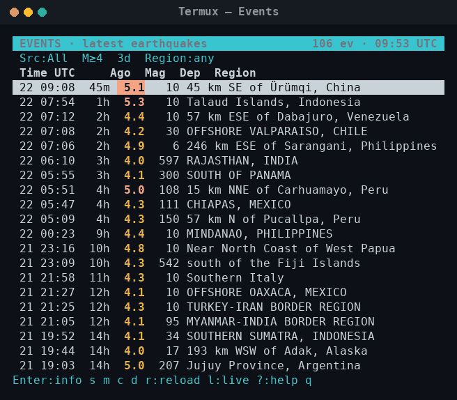
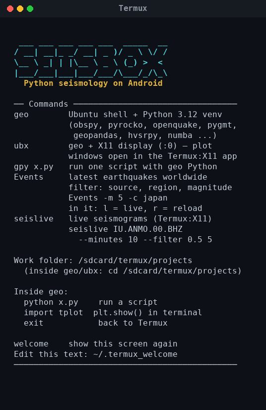
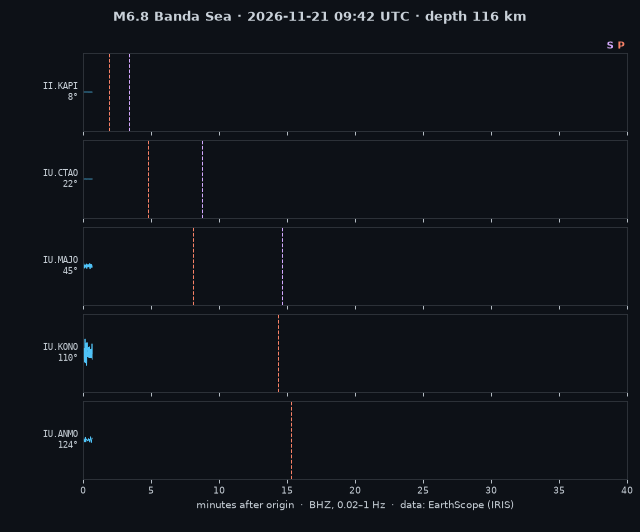
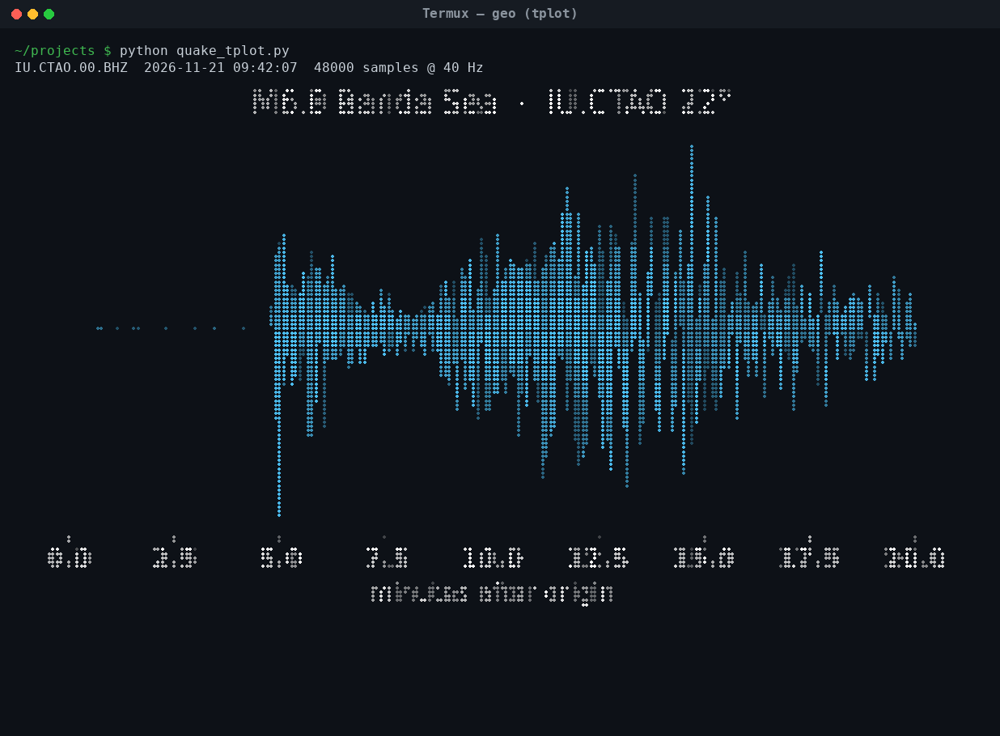
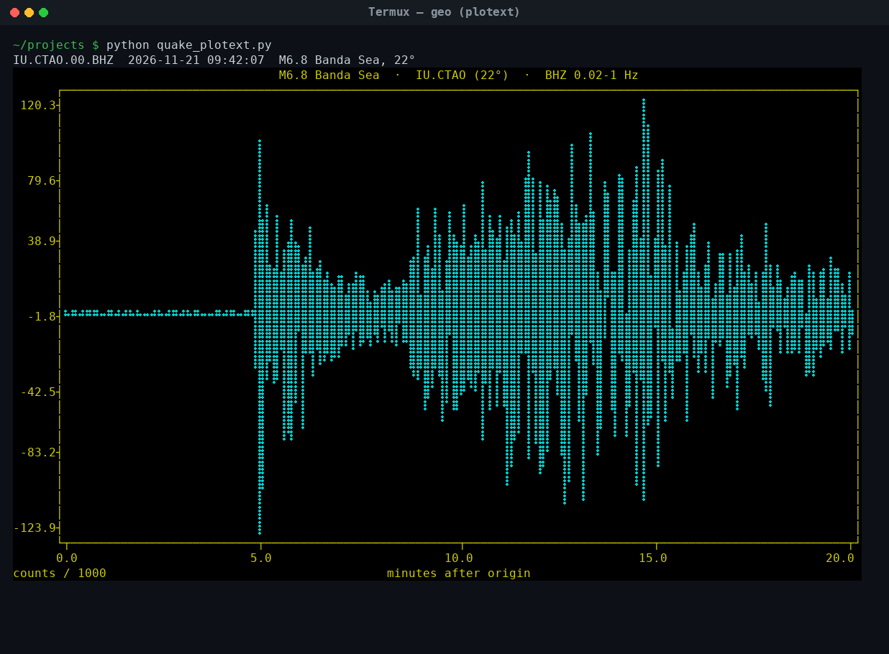
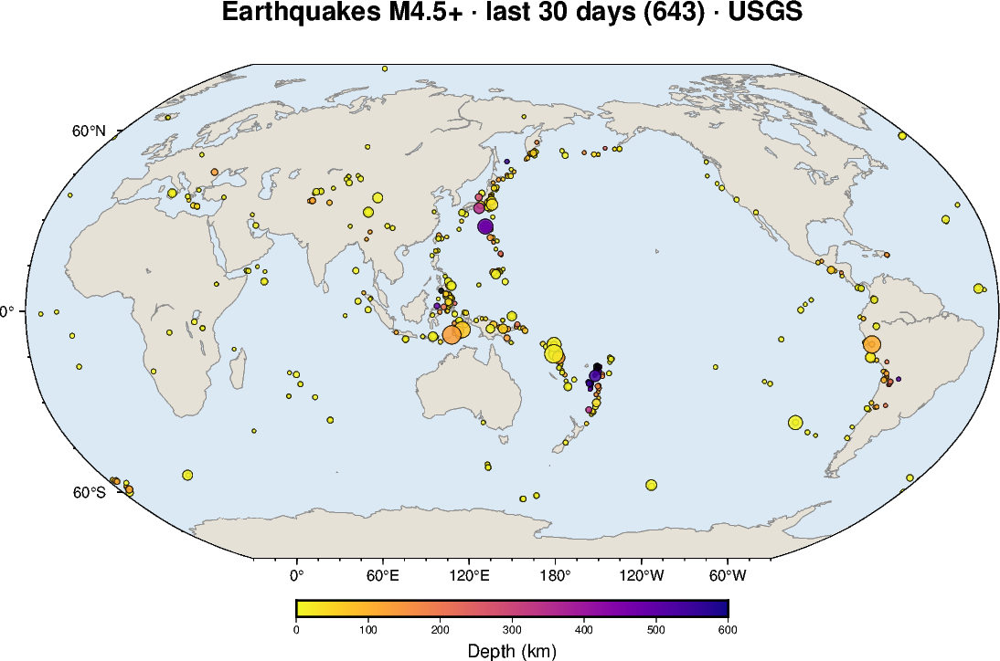
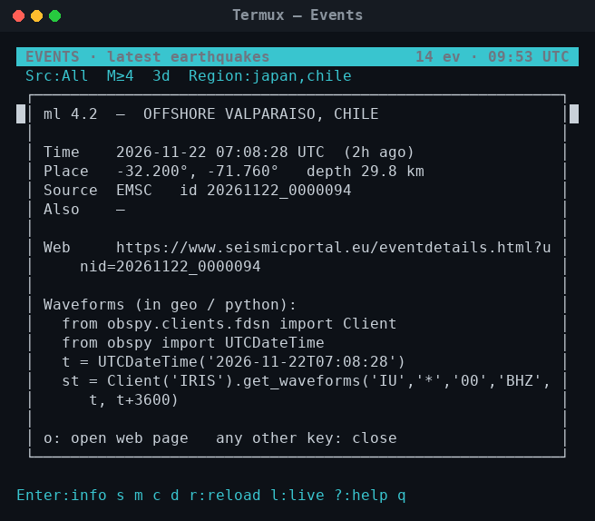
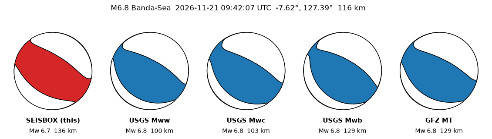

# SEISBOX

**A Python seismology workstation on an Android phone.** It runs in Termux, with no root.

SEISBOX gives you a full Python 3.12 scientific and seismology stack on your phone:
ObsPy, Pyrocko, OpenQuake Engine, MSNoise, PyGMT (with GMT 6.5), GeoPandas, hvsrpy, NumPy, SciPy,
pandas, numba and more. You also get plots in the terminal, real plot windows through
Termux:X11, and a live seismogram viewer.

<p align="center">
  
  &nbsp;
  
</p>

<p align="center">
  
</p>

```
geo                 # enter the Python environment
python my_script.py # use obspy, pygmt, openquake ... as on a PC
seislive IU.ANMO.00.BHZ --filter 0.5 5   # live waveforms from EarthScope SeedLink
```

---

## Contents

1. [How it works](#1-how-it-works)
2. [Requirements](#2-requirements)
3. [Install from zero (quick)](#3-install-from-zero-quick)
4. [Install from zero (step by step, manual)](#4-install-from-zero-step-by-step-manual)
5. [Daily use](#5-daily-use)
6. [Plotting: terminal, X11 windows, files](#6-plotting)
7. [Included tools](#7-included-tools)
8. [Repository layout](#8-repository-layout)
9. [Updating, backup, uninstall, offline bundle](#9-updating-backup-uninstall)
10. [Troubleshooting](#10-troubleshooting)

---

## 1. How it works

```
Android
 └─ Termux app              (Linux userland, Android libc "Bionic")
     ├─ termux-x11          (X server → shows windows in the Termux:X11 app)
     ├─ aliases: geo, ubx, gpy, seislive
     └─ proot-distro
         └─ Ubuntu 24.04    (normal glibc Linux, runs without root via proot)
             ├─ apt: python3.12, GMT 6.5, GDAL 3.8, Tk, compilers
             └─ /root/geo   ← Python venv with all science packages
```

**Why not just use Termux's own Python?**

* Termux only ships the newest Python (3.14 at the time of writing). OpenQuake, numba and
  others need 3.12.
* Termux uses Android's C library (Bionic), not glibc. The ready-made Linux wheels on PyPI
  (`manylinux_aarch64`) only work on glibc. In Termux, NumPy, SciPy, numba, Shapely, pyproj and
  other packages would all have to be **compiled from source**, which takes hours, often
  fails, and can break on Termux updates.
* GMT, which PyGMT needs, is not packaged for Termux.

Inside Ubuntu, `pip install` downloads prebuilt wheels and `apt install gmt` simply works.
proot is **not** a virtual machine: code runs at native CPU speed. Only heavy file I/O is
somewhat slower. The cost is about 3–5 GB of storage.

`/sdcard` (your phone's shared storage) is visible inside Ubuntu at the same path. You
can edit scripts with any Android editor and run them in `geo`.

---

## 2. Requirements

| Item | Notes |
|---|---|
| Android 7+ phone, **64-bit ARM (aarch64)** | Almost every phone from the last 7 years |
| **~5 GB free** internal storage | Ubuntu, compilers, Python packages |
| Internet | ~1.5 GB of downloads during install |
| **Termux** app | From **F-Droid** or **GitHub**, *not* Google Play (the Play version is outdated) |
| **Termux:X11** app (optional) | Only for plot windows and `seislive` |
| 30–90 minutes | Mostly pip downloading/compiling (pyrocko builds from source) |

Download links:

* Termux: <https://f-droid.org/packages/com.termux/> or <https://github.com/termux/termux-app/releases>
  (pick `termux-app_*_arm64-v8a.apk`)
* Termux:X11: <https://github.com/termux/termux-x11/releases> (download the `app-arm64-v8a-debug.apk` from the *nightly* release)

> Install all Termux apps from the **same source** (all GitHub or all F-Droid). Mixing them
> gives a signature error.

---

## 3. Install from zero (quick)

1. Install the **Termux** app (and optionally **Termux:X11**) from the links above. Open Termux.
2. Paste:

   ```bash
   pkg update -y && pkg install -y git
   git clone https://github.com/NimaDolatabadi/SEISBOX ~/SEISBOX
   bash ~/SEISBOX/install.sh
   ```

3. Tap **Allow** when Android asks for storage permission.
4. Wait. It ends with a self-test that prints `ok` for each package and `All good.`
5. Close Termux completely (swipe it away, or type `exit`) and open it again. You will see the
   SEISBOX welcome screen.

Keep the screen on, or keep Termux in the foreground, during the install. Android may pause
background apps. You can also pull down the Termux notification and tap **Acquire wakelock**.

**Install options**, set before `bash install.sh`:

```bash
SEISBOX_PY=latest bash ~/SEISBOX/install.sh        # newest package versions instead of the tested lock
SEISBOX_PROJECTS=/sdcard/Documents/seis bash ~/SEISBOX/install.sh   # different work folder
```

The default (`lock`) installs exactly the versions in `requirements-lock.txt`, which are known to
work together. `install.sh` is safe to run again: finished steps are skipped.

---

## 4. Install from zero (step by step, manual)

This is exactly what `install.sh` does, so you can understand it, repeat it or fix one step.

### 4.1 Termux base

```bash
pkg update -y && pkg upgrade -y
pkg install -y proot-distro git curl wget chafa gnuplot x11-repo
pkg install -y termux-x11-nightly          # X server for plot windows (needs x11-repo)
termux-setup-storage                       # tap "Allow" → gives Termux /sdcard access
mkdir -p /sdcard/termux/projects           # your work folder
```

| Package | Why |
|---|---|
| `proot-distro` | Installs and runs the Ubuntu container without root |
| `git`, `curl`, `wget` | Downloading |
| `chafa` | Draws images as text characters (terminal plots) |
| `gnuplot` | Optional quick plotting in Termux itself |
| `x11-repo`, `termux-x11-nightly` | X11 server that shows Linux windows in the Termux:X11 app |

### 4.2 Ubuntu 24.04 container

```bash
proot-distro install --name ubuntu ubuntu:24.04
proot-distro login ubuntu          # you are now root@localhost inside Ubuntu
```

The version is pinned to **24.04** on purpose: it ships Python 3.12 and GDAL 3.8.4, which this
stack is tested with. Its files live in
`$PREFIX/var/lib/proot-distro/containers/ubuntu/rootfs`.

> Never put the container or the venv on `/sdcard`. Shared storage does not allow executables
> or symlinks.

### 4.3 System packages inside Ubuntu

Run these as root inside Ubuntu (`proot-distro login ubuntu`):

```bash
apt-get update
apt-get install -y \
  python3 python3-venv python3-dev python3-pip python3-tk \
  build-essential gfortran pkg-config git curl ca-certificates \
  gmt gmt-dcw gmt-gshhg libgmt-dev ghostscript \
  libgdal-dev gdal-bin \
  chafa x11-utils
```

| Package | Why |
|---|---|
| `python3*` | Python 3.12 + venv + headers |
| `python3-tk` | Tk backend so matplotlib can open windows on X11 |
| `build-essential`, `gfortran`, `pkg-config` | Compile packages that have no ARM wheel (pyrocko, GDAL bindings) |
| `gmt gmt-dcw gmt-gshhg libgmt-dev ghostscript` | GMT 6.5 with coastlines/borders, required by PyGMT |
| `libgdal-dev gdal-bin` | GDAL library for the `osgeo.gdal` bindings (OpenQuake, rasters) |
| `chafa` | Terminal image display used by `tplot` |

### 4.4 The `geo` Python venv

```bash
python3 -m venv /root/geo
/root/geo/bin/pip install -U pip setuptools wheel

# GDAL's Python bindings must match the system GDAL exactly (3.8.4)
/root/geo/bin/pip install numpy==2.2.6
/root/geo/bin/pip install --no-build-isolation gdal==$(gdal-config --version)

# Everything else, exact versions (repo copied/bound at /opt/seisbox)
/root/geo/bin/pip install --no-deps -r /opt/seisbox/requirements-lock.txt
```

`--no-deps` is used because OpenQuake declares `gdal~=3.13`, but Ubuntu 24.04 has GDAL 3.8.4.
The lock file already lists every dependency, so pip doesn't need to resolve anything. OpenQuake
works with 3.8.4. `pip check` will report this mismatch; that is expected. If a raster
input to OpenQuake ever fails, this is the first thing to suspect.

Notable pins:

* `numpy==2.2.6`, `numba==0.61.2`: numba only supports specific NumPy versions.
* `plotext==5.3.2`: version 6 removed the `plt.plot()` style API.
* `setuptools<81`: MSNoise 1.6.5 still imports `pkg_resources`, which setuptools 81 removed.
  You may see a harmless `pkg_resources is deprecated` warning when running `msnoise`.

### 4.5 Terminal plotting helper (`tplot`)

```bash
cp /opt/seisbox/ubuntu/tplot.py /root/geo/lib/python3.12/site-packages/
```

### 4.6 `geo` shell startup file

```bash
cp /opt/seisbox/ubuntu/geo_rc /root/.geo_rc
```

It loads the normal `.bashrc` and activates the venv. When an X11 display is present (`ubx`),
it also sets matplotlib to the Tk backend.

### 4.7 Termux side: shortcuts and welcome screen

Back in Termux (`exit` out of Ubuntu):

```bash
install -m 755 ~/SEISBOX/termux/bin/seislive $PREFIX/bin/
cp ~/SEISBOX/termux/seisbox.bashrc ~/.seisbox.bashrc
echo '[ -f ~/.seisbox.bashrc ] && . ~/.seisbox.bashrc' >> ~/.bashrc
cp ~/SEISBOX/termux/welcome.txt ~/.termux_welcome
cp ~/SEISBOX/termux/gnuplot ~/.gnuplot
touch ~/.hushlogin
cp -rn ~/SEISBOX/projects/. /sdcard/termux/projects/
source ~/.bashrc
```

---

## 5. Daily use

All commands are typed in **Termux**:

| Command | What it does |
|---|---|
| `geo` | Opens an Ubuntu shell with the venv active, so `python` means Python 3.12 + all packages. `exit` returns to Termux. |
| `ubx` | Same as `geo`, plus it starts the X server and sets `DISPLAY=:0`. Matplotlib windows open in the Termux:X11 app. |
| `gpy script.py` | Runs one script with the geo Python without opening a shell. Use full paths, e.g. `gpy /sdcard/termux/projects/x.py`. |
| `seislive ...` | Live waveform viewer (see below). |
| `Events` | Latest earthquakes worldwide, filterable (see below). Runs in Termux directly, so it starts instantly. |
| `welcome` | Shows the command list again. |

Typical session:

```bash
geo
cd /sdcard/termux/projects
python my_analysis.py
ipython                       # interactive
exit
```

Example (ObsPy):

```python
from obspy.clients.fdsn import Client
from obspy import UTCDateTime
import tplot, matplotlib.pyplot as plt

st = Client("EARTHSCOPE").get_waveforms("IU", "ANMO", "00", "BHZ",
                                        UTCDateTime() - 3600, UTCDateTime() - 3000)
st.filter("bandpass", freqmin=0.5, freqmax=5)
st.plot(show=False); plt.show()          # drawn right in the terminal
```

---

## 6. Plotting

There are three ways to see plots:

<p align="center"></p>

1. **In the terminal (`tplot`)**: add `import tplot` at the top of a script. After that,
   `plt.show()` draws any matplotlib figure in the terminal with `chafa`, using braille dots
   (2×4 per character, so lines stay sharp). Use `plt.show(size="120x35")` to choose the size,
   and zoom out in Termux (pinch) for more detail. Try `python /sdcard/termux/projects/tplot_demo.py`.
   If your font shows boxes instead of dots, switch to the older filled-block look:
   `export TPLOT_SYMBOLS=block+border+space TPLOT_ARGS=" "`.
2. **Real windows (`ubx`)**: open the Termux:X11 app once, then run `ubx` in Termux. Matplotlib
   uses TkAgg, and windows appear in Termux:X11 with zoom and pan. Switch back to Termux with
   the Android app switcher.
3. **Files**: `plt.savefig("/sdcard/termux/projects/fig.png", dpi=200)` and open it in the gallery.
   PyGMT: `fig.savefig("/sdcard/.../map.png")`.

**`plotext`** (5.3.2, also installed) draws line plots natively in the terminal. The axes, ticks and
labels are real characters, so text is sharper than with `tplot`, but it only does simple plot
types. The same seismogram ([`docs/tools/quake_plotext.py`](docs/tools/quake_plotext.py)):

<p align="center"></p>

PyGMT and GMT 6.5 work fully inside `geo`. This map of the last 30 days of M4.5+ quakes is made on the
phone by [`docs/tools/make_map.py`](docs/tools/make_map.py):

<p align="center"></p>

The animated seismograms at the top come from [`docs/tools/make_seismogram.py`](docs/tools/make_seismogram.py).
It downloads the M6.8 Banda Sea earthquake (21 Nov 2026) from five stations 8°–124° away via
ObsPy, and marks the TauP P and S arrival times.

---

## 7. Included tools

Copied to your work folder (`/sdcard/termux/projects`) on install.

### `seislive`: live seismograms

Streams real-time data from the EarthScope (IRIS) SeedLink server and draws a scrolling
plot in Termux:X11. It is fast enough for phones: it uses ring buffers, stateful causal filtering
and pixel-column min/max decimation.

```bash
seislive                                        # default: IU.ANMO.00.BHZ, 10 min
seislive IU.ANMO.00.BHZ IU.COLA.00.BHZ --minutes 10 --filter 0.5 5
```

### `Events`: latest earthquakes worldwide

A full-screen list of recent earthquakes from **USGS**, **EMSC** and **GFZ GEOFON** (FDSN event
services, no account needed). With source `All`, a quake reported by several agencies is shown
once, with all of them in the `Src` column (e.g. `USGS+EMSC+GFZ`). It uses only Python's standard
library and runs on Termux's own Python, so it starts instantly and doesn't need `geo`.

```bash
Events                         # last 3 days, M≥4, all sources
Events -m 5 -c japan           # start with filters
Events -s emsc -d 7 -c iran    # one source, 7 days
Events --list -m 4.5 -c chile  # plain table instead of the TUI (for scripts / piping)
Events --live                  # start in live mode (30 s); Events --live 15 for every 15 s
```

| Key | Action |
|---|---|
| ↑ ↓ PgUp PgDn | move |
| `i` (or `F`) | focal mechanism **+ own waveform inversion** (see `quakemt` below) |
| Enter | details: time, location, depth, agencies, web link, and a ready ObsPy snippet to fetch waveforms |
| `o` | open the quake's page in the browser |
| `s` | source: All → USGS → EMSC → GFZ |
| `m` | minimum magnitude |
| `c` or `/` | country/region filter; commas mean OR (`japan,chile`). Country names and ISO codes (`iran`, `IRN`, `usa`, `uk`, `türkiye`) use **real country borders** (Natural Earth 1:50m, incl. islands and overseas territories): the epicentre must be inside the country, or offshore within 200 km of its coast. Any other text (`banda sea`, `aleutian`) is matched against the region name |
| `d` | time window: 1 → 3 → 7 → 30 days |
| `r` | reload now (it also refreshes itself every 5 minutes) |
| `f` | **focal mechanism**: published USGS/GFZ moment tensors of the selected quake (see below) |
| `l` | **live mode** on/off: reloads every 30 s with a countdown in the header. Quakes that arrive while you watch get a green `●` for 10 minutes, and the phone beeps |
| `?` / `q` | help / quit |

<p align="center"></p>

Magnitudes are coloured: yellow ≥ 4, red ≥ 5, inverted red ≥ 6. A service returns at most 1000
events per request, so `Events` pages back in time until the whole window is covered (up to 10
requests per service; for example M1+ over 7 days is about 3400 events). Only if that is still not
enough does the bottom bar warn that older events are cut off.

USGS and EMSC usually answer in under a second, while GFZ can take 5–10 s. The list fills in as each
service answers, and a service that fails keeps its previous results on screen.

### `quakemt`: focal mechanisms and moment tensors

Select a quake in `Events` and press **`f`** (published) or **`i`** (own inversion; `F` also works),
or run `quakemt` directly (`quakemt --help`).

The terminal shows only the **source parameters and mechanism**: Mw, M0, depth, both nodal planes,
P/T/B axes, fault type and DC/CLVD %. For your own inversion it also shows the depth range and fit
quality. Everything else goes into the saved summary file.

**Where results are saved.** Before a run, `Events` asks for a folder name. Press Enter to accept
the suggested name, or type your own. The folder is created under `/sdcard/termux/projects/mt/`:

```
mt/
├── index.csv                                   ← one line per run: time, magnitude, region, folder, result
└── 2026-11-21_0942UTC_M6.8_Banda-Sea/          ← date_time_magnitude_region (or your own name)
    ├── published_mechanisms.png                ← f: USGS/GFZ beachballs
    ├── published_summary.txt                   ← f: full text incl. tensors, agency comparison
    ├── published.json
    ├── inversion_mechanism.png                 ← F: own solution (red) next to USGS/GFZ (blue)
    ├── inversion_waveform_fits.png             ← F: data (black) vs synthetics (red), per station
    ├── inversion_summary.txt                   ← F: full log: stations, depth search, fit, Kagan angles
    └── inversion.json
```

`f` and `i` write different files, so running both keeps both. On the command line, `--name` sets the
folder name.

**Viewing images.** Images are never drawn in the terminal. After a run, press `o` (mechanism) or
`w` (waveform fits) to open them in **Termux:X11** with zoom and pan. The same works for any image:

```bash
seisview /sdcard/termux/projects/mt/2026-11-21_0942UTC_M6.8_Banda-Sea/*.png   # ←/→ next, q close
```

<p align="center"></p>

**Layer 1 (`f`, seconds): published solutions.** Every moment tensor or focal mechanism USGS has for
the event (W-phase *Mww*, centroid *Mwc*, body-wave *Mwb*, regional *Mwr*, first-motion), plus the
GFZ GEOFON moment tensor. They usually appear 20–60 min after an M5+ quake.

**Layer 2 (`i`, about 1–3 min): own inversion from raw waveforms.**

1. Picks about 24–33 global broadband stations (IU, II, G, GE, IC, CU, GT, MN) 25–90° away (12–60° below M6), spread
   evenly in azimuth, and downloads 3-component long-period (LH, 1 sample/s) data and instrument
   responses from all FDSN data centres through the IRIS federator.
2. Removes the response and rotates to Z/R/T displacement, filtered at 50–100 s (40–90 s below M6).
3. Gets Green's functions from **IRIS Syngine** (AxiSEM, anisotropic PREM): six unit moment tensors
   for all stations at each trial depth. The heavy computation happens on IRIS's servers.
4. Solves a **deviatoric moment tensor** by linear least squares on full waveforms (body and
   surface waves). It grid-searches centroid depth (extending the search if the best depth is at the
   edge) and centroid time shift. Each station gets a small time lag (±30 s, separately for
   Rayleigh Z/R and Love T) to absorb 3-D Earth travel-time errors, as in the CAP method.
5. Drops traces it cannot fit, re-solves, and reports Mw, M0, both nodal planes, P/T/B axes,
   fault type, double-couple / CLVD %, centroid depth (with the range that fits nearly as well),
   variance reduction (VR), azimuthal gap, and the **Kagan angle** (difference) to each published solution.

Validation on recent quakes (published solutions = USGS):

| Quake | Distances / stations | SEISBOX result | Published | Difference |
|---|---|---|---|---|
| M6.8 Banda Sea, 21 Nov 2026, 116 km | 25–90°, 26 stations, gap 23° | Mw 6.75, thrust 305°/56°/93°, 136 km (116–156), VR 62 % | USGS Mww 6.81, 299°/65°/86°, 100 km · GFZ 6.79, 129 km | Kagan 12–13°, ΔMw −0.02 to −0.09 |
| M6.7 Peru, 21 Nov 2026, 108 km | 25–90°, 19 stations, gap 58° | Mw 6.57, strike-slip 20°/68°/0°, 128 km (88–148), VR 50 % | USGS Mww 6.73, 21°/82°/−4°, 130 km · GFZ 6.68, 115 km | Kagan 6–15°, ΔMw −0.10 to −0.16 |
| M5.9 Yanglong, China, 21 Nov 2026 | 12–60°, 19 stations | **refused**: only 5 traces with clear signal | GFZ Mw 5.70 | Came 63 min after the M6.8 Banda Sea quake, whose surface waves still filled the records. The tool says so instead of guessing. |

**Limits.**
- Needs about **M5.5+**: smaller quakes are too weak at 50–100 s periods and need local data and
  models instead.
- **Depth is the least certain number** (often ±20 km). Use the reported range.
- The two nodal planes fit equally well, so the waveforms **cannot tell which one is the real
  fault**. Aftershocks, surface rupture or known faults decide that.
- Rupture length, area and slip are not measured by this method.
- Quality drops with fewer stations or a large azimuthal gap (ocean regions). Check VR and the
  fit plot before trusting a result. The comparison with USGS/GFZ is the quickest sanity check.

### `irsc_bulletin`: Iranian Seismological Center catalogue

IRSC has no FDSN service, but it reports to the ISC as agency `TEH`. This tool queries the ISC
and keeps the IRSC origins and magnitudes, then writes a CSV.

```bash
geo
cd /sdcard/termux/projects/irsc_bulletin
python irsc_bulletin.py --start 2024-06-01 --end 2024-07-01
python irsc_bulletin.py --start 2024-01-01 --lat 35.7 --lon 51.4 --radius 2
python irsc_tui.py            # full-screen form (curses)
```

### MSNoise: ambient-noise monitoring (dv/v)

MSNoise 1.6.5 is installed with a SQLite database backend (no MySQL server needed). Each project
is a folder holding its `db.ini` and database:

```bash
geo
mkdir -p /sdcard/termux/projects/noise && cd /sdcard/termux/projects/noise
msnoise db init                 # choose 1 (sqlite), then accept defaults
msnoise config set data_folder=/sdcard/termux/projects/noise/SDS
msnoise config set data_structure=SDS
msnoise populate                # fill the station table from the archive
msnoise scan_archive --init
msnoise new_jobs --init
msnoise compute_cc              # cross-correlations
msnoise info                    # status of config and jobs
```

`msnoise admin` starts the web configuration page. Open the printed `http://localhost:5000`
address in your phone's browser.

Ambient-noise processing is heavy. On a phone, start with a few stations and days, and keep
Termux in the foreground (or use **Acquire wakelock**).

---

## 8. Repository layout

```
SEISBOX/
├── install.sh                  # run in Termux: does everything (online)
├── seisbox-pack.sh             # make an offline bundle of this phone's setup
├── seisbox-restore.sh          # install that bundle on another phone
├── requirements-lock.txt       # exact tested versions (default)
├── requirements.txt            # main packages, unpinned (SEISBOX_PY=latest)
├── ubuntu/
│   ├── setup.sh                # runs inside Ubuntu: apt + venv + pip + self-test
│   ├── quakemt.py              # → /root/geo/bin/quakemt (focal mechanisms / MT inversion)
│   ├── imgview.py              # → /root/geo/bin/imgview (X11 image window for seisview)
│   ├── geo_rc                  # → /root/.geo_rc
│   └── tplot.py                # → venv site-packages
├── termux/
│   ├── seisbox.bashrc          # → ~/.seisbox.bashrc (aliases geo, ubx, gpy, welcome)
│   ├── welcome.txt             # → ~/.termux_welcome
│   ├── gnuplot                 # → ~/.gnuplot (braille terminal output)
│   └── bin/
│       ├── seislive            # → $PREFIX/bin/seislive
│       ├── Events              # → $PREFIX/bin/Events (+ events)
│       ├── quakemt             # → $PREFIX/bin/quakemt (runs the geo tool below)
│       └── seisview            # → $PREFIX/bin/seisview (open images in Termux:X11)
├── docs/
│   ├── media/                  # README images and GIFs
│   └── tools/                  # scripts that make them (see "Regenerating the images")
├── examples/tplot_demo.py
└── projects/
    ├── seis_live/seis_live.py
    └── irsc_bulletin/{irsc_bulletin.py, irsc_tui.py}
```

---

## 9. Updating, backup, uninstall

**Add a package**: `geo`, then `pip install <name>`.

**Update SEISBOX files**: `cd ~/SEISBOX && git pull && bash install.sh`.

**Back up the whole environment** (to restore later or move to another phone):

```bash
proot-distro backup ubuntu --output /sdcard/seisbox-ubuntu.tar.gz
proot-distro restore /sdcard/seisbox-ubuntu.tar.gz
```

### Offline bundle: copy your setup to other phones

No internet or compiling is needed on the other phone. Make the bundle on a phone where SEISBOX
already works:

```bash
bash ~/SEISBOX/seisbox-pack.sh            # → /sdcard/SEISBOX-bundle/  (~2–3 GB, 10–30 min)
```

The bundle folder contains:

| File | What |
|---|---|
| `Termux.apk`, `Termux-X11.apk`, `Termux-API.apk` | The apps, copied from your phone |
| `termux-prefix.tar.gz` | All Termux packages |
| `ubuntu.tar.gz` | Ubuntu 24.04 + the whole `geo` Python environment |
| `seisbox-repo.tar.gz` | This repo (shortcuts, welcome screen, projects) |
| `seisbox-restore.sh`, `README.txt`, `SHA256SUMS` | Installer, instructions, checksums |

These are **not** included: your Termux home folder, shell histories, pip caches,
Claude Code data and logins, SSH host keys (new ones are generated), temp files and logs.

Copy the folder to the new phone (USB cable, SD card, Google Drive, …), then on that phone:

1. Install `Termux.apk` (and `Termux-X11.apk`). Uninstall any Termux from Google Play first.
2. Open Termux and wait until the first setup finishes.
3. `termux-setup-storage` → **Allow**
4. `bash /sdcard/SEISBOX-bundle/seisbox-restore.sh`
5. Close and reopen Termux, then type `geo`.

The new phone must be 64-bit ARM (aarch64) and have about 6 GB free. The restore replaces that
phone's Termux packages and Ubuntu container. Its Termux home folder is kept.

The bundle is too large for git. Share it as a file, or attach it to a GitHub Release
(files must be < 2 GB each: `split -b 1900M ubuntu.tar.gz ubuntu.tar.gz.part-`, and
rejoin with `cat ubuntu.tar.gz.part-* > ubuntu.tar.gz`).

**Rebuild just the venv**:

```bash
proot-distro login ubuntu -- rm -rf /root/geo
bash ~/SEISBOX/install.sh
```

**Uninstall everything**:

```bash
proot-distro remove ubuntu
rm -f $PREFIX/bin/seislive ~/.seisbox.bashrc ~/.termux_welcome ~/.hushlogin
sed -i '/seisbox.bashrc/d' ~/.bashrc
```

### Regenerating the images

All README media are made on the phone from real data. Ubuntu can't see the Termux home
folder by default, so the repo is bound into it as `/opt/seisbox`:

```bash
cd ~/SEISBOX
G="proot-distro login ubuntu --bind $HOME/SEISBOX:/opt/seisbox -- bash -c"

# PyGMT map and animated seismograms (geo Python)
$G 'cd /opt/seisbox && /root/geo/bin/python docs/tools/make_map.py'
$G 'cd /opt/seisbox && /root/geo/bin/python docs/tools/make_seismogram.py'

# terminal screenshots: record in Termux (needs: pip install pyte), draw in geo (Pillow)
python docs/tools/term_capture.py events docs/media/events.json
$G 'cd /opt/seisbox && /root/geo/bin/python docs/tools/term_render.py docs/media/events.json docs/media/events.gif --title "Termux — Events"'
rm docs/media/events.json
```

The same works for `welcome` and `tplot` (`term_capture.py welcome|tplot`). Use `--frame N` to save
one frame as PNG.

---

## 10. Troubleshooting

| Problem | Fix |
|---|---|
| `[Process completed (signal 9)]` or Termux gets killed during long jobs | Android 12+ "phantom process killer". On Android 14+: Developer options → **Disable child process restrictions**. On Android 12–13, from a PC: `adb shell "/system/bin/device_config put activity_manager max_phantom_processes 2147483647"` |
| Install stops when the screen turns off | Termux notification → **Acquire wakelock**, then run `install.sh` again |
| `Permission denied` on `/sdcard` | Run `termux-setup-storage` and allow. On Android 11+ check App info → Permissions → Files → Allow all |
| `ubx` / `seislive` shows nothing | Open the Termux:X11 app. If it is stuck: `pkill -f termux-x11`, then run `ubx` again |
| `_tkinter` / `TclError: no display` | You are in `geo`, not `ubx`. Use `import tplot`, or start with `ubx` |
| pip fails building a package | Check that `build-essential python3-dev` are installed (step 4.3). Re-run `install.sh`; finished steps are skipped |
| `pip check` complains about `gdal` and `openquake-engine` | Expected (see 4.4), harmless |
| Termux app installs fail with a signature error | All Termux apps must come from the same source (GitHub *or* F-Droid) |
| `pkg` mirror errors | `termux-change-repo` and choose another mirror |

---

Built and used on Android 17 (aarch64) with Ubuntu 24.04.5 under proot-distro and Python 3.12.3.
